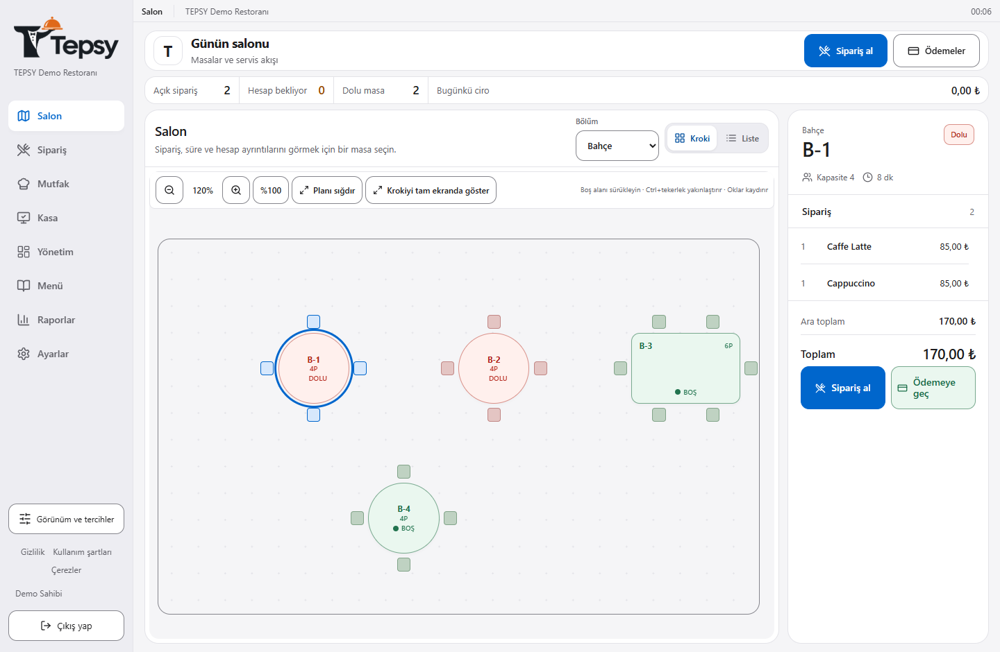
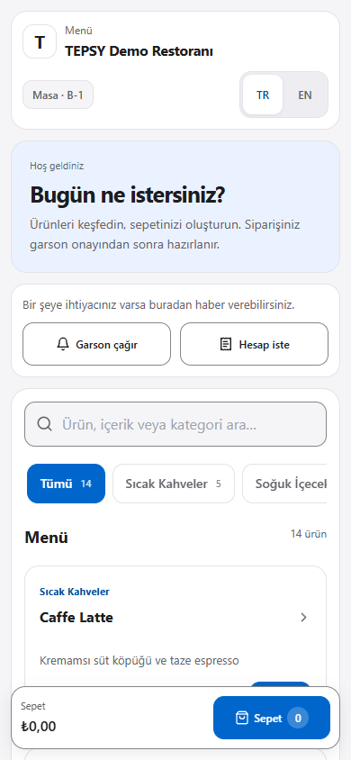

# TEPSY

Local restaurant management: **tables → orders → kitchen → checkout**.

One Node.js server, one SQLite database. Staff use browsers on the local network; customers scan table QR codes. Turkish/English, light/dark themes, responsive layouts.

| Staff floor plan and table account                                               | Customer QR menu                                       |
| -------------------------------------------------------------------------------- | ------------------------------------------------------ |
|  |  |

## Quick Start

Requires [Node.js 24+](https://nodejs.org/) and [Python 3.8+](https://www.python.org/).

Supported browsers: Chrome 111+, Firefox 128+ and Safari 16.4+.

On Windows, double-click [START.bat](START.bat). It sets up the local installation if
needed, starts TEPSY, opens the browser and shows addresses for other devices on
the same Wi-Fi or local network. Keep the server computer on during use.

Run `START.bat` again to apply changed project files. It automatically updates and
restarts the installed server when needed, retaining restaurant data and settings.

The sign-in screen includes **Forgot password** and **Create a new restaurant**.
Owners recover access with a short-lived code generated by `OWNER-RECOVERY.bat`
on the server computer. Another restaurant is created as a separate installation
after verifying the current owner; existing data is preserved. See
[account recovery and independent restaurants](docs/OPERATIONS.md#account-recovery-and-independent-restaurants).

```sh
npm run demo          # Try the demo
npm run setup         # Set up your restaurant
npm run start:local   # Start the server
npm run stop:local    # Stop the server
```

Demo credentials: code `DEMO01`, owner password `TepsyDemo123!`, staff PIN `1234`.

## Features

| Area       | Details                                                          |
| ---------- | ---------------------------------------------------------------- |
| Floor      | Sections, editable floor plan, live table status                 |
| Orders     | Staff and QR ordering with waiter approval, kitchen workflow     |
| Checkout   | Cash/card, split payments, receipts, discounts, recorded refunds |
| Operations | Cash shifts, reports, activity history, full recovery backups    |
| Menu       | Product photos, business logo, business currency setup           |
| Access     | Owner/staff roles, remembered devices, session management        |

In checkout, **Split / custom payment** opens one window for equal shares, custom
amounts and selected products. Optional tip entry expands on request in both
checkout and the QR cart; an entered tip stays visible in the collapsed summary.

Each POS addition becomes a new pending kitchen ticket, including additions to a
delivered account. Currency can be chosen before trading starts and is locked
after the first order or cash shift. Recorded card payments and refunds document
external transactions; TEPSY does not approve or initiate bank transfers.

## Tech Stack

**Next.js 15 · React 18 · Tailwind CSS · Socket.IO · Prisma 5 · SQLite**

## Development

```sh
npm ci && npx prisma generate
python3 scripts/initialize-sqlite.py --database prisma/dev.db
npm run db:push && npm run dev
```

These commands create a new, empty development database. Never run `db:push` against
an existing restaurant database; `START.bat` and `npm run start:local` upgrade
installed restaurants automatically (see [Database Upgrade](docs/OPERATIONS.md#database-upgrade)).

| Command                       | Purpose                     |
| ----------------------------- | --------------------------- |
| `npm run dev`                 | Development server          |
| `npm run build` / `npm start` | Production build and server |
| `npm test`                    | Unit tests                  |
| `npm run lint`                | ESLint check                |
| `npm run verify:release`      | Full release gate           |

## Project Structure

| Directory                   | Contents                               |
| --------------------------- | -------------------------------------- |
| `src/app`                   | Pages and API routes                   |
| `src/components`, `src/lib` | Shared UI and business logic           |
| `prisma`                    | Schema and migrations                  |
| `scripts`                   | Installation, backup and release tools |
| `tests`                     | Unit, integration and browser tests    |
| `docs`                      | Architecture and operations            |

## Documentation

[Architecture](docs/ARCHITECTURE.md) · [Operations](docs/OPERATIONS.md) · [Tests](tests/README.md) · [Security](SECURITY.md)

## License

Copyright (c) 2026 Arda Çankaya and TEPSY contributors. Licensed under [MIT](LICENSE).

When redistributing copies or substantial portions of the software, preserve the
copyright notice and MIT permission notice in [LICENSE](LICENSE). An author's name
or repository link alone does not replace these notices. Commercial use is
permitted under the MIT license. Third-party components retain their own licenses
and copyright notices.
